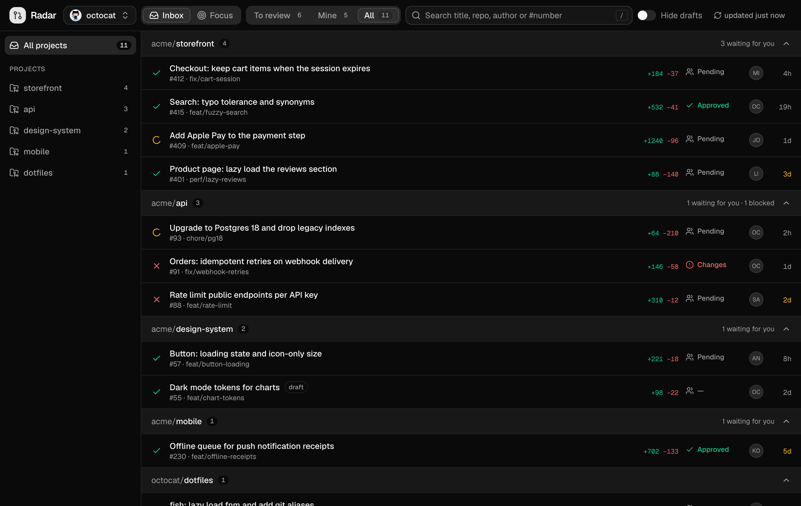
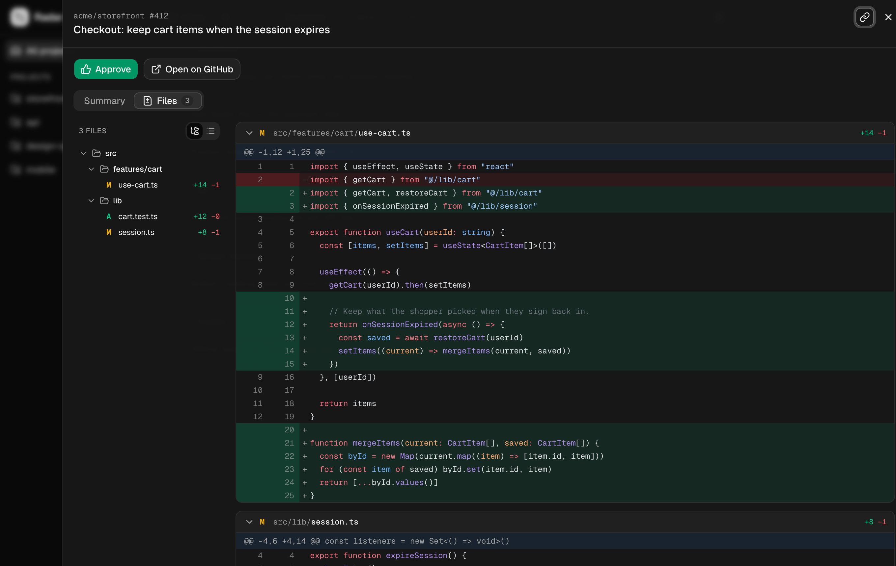

# PR Radar

A macOS desktop app (Tauri) that lists your open pull requests and the reviews requested from you, grouped by project. It uses the accounts you are already logged into with the `gh` CLI.





## Features

- **Multiple gh accounts.** Switch between every account logged into `gh`. Each one uses its own token, so switching in the app doesn't change the active account in your terminal.
- **Inbox and Focus views.** Inbox groups PRs by repository. Focus splits them into "waiting for your review", "your blocked PRs", "ready to merge" and "waiting on others".
- **Filters.** Show PRs to review, your own PRs, or all of them, with search and a toggle to hide drafts.
- **Diffs in the app.** Syntax highlighting (Shiki) and a file tree or flat list.
- **Approve without leaving the app,** with an optional comment.
- **Open in VS Code.** Checks out the PR in a separate git worktree under `~/.pr-radar/worktrees`, so your clone stays untouched.
- **Right-click a PR** to open it on GitHub or copy its link.

## Running

You need Node (version in `.node-version`), pnpm, Rust (`cargo`) and a logged-in `gh` (`gh auth status`).

```sh
pnpm install
pnpm app          # tauri dev: native window with hot reload
pnpm app:build    # builds src-tauri/target/release/bundle/macos/PR Radar.app
```

To install the app, copy the built `.app` to `/Applications`.

`pnpm dev` serves only the frontend at http://127.0.0.1:1420. Without Tauri the `gh` calls fail, so open http://127.0.0.1:1420/?demo to browse with fictional data instead. The screenshots above use that demo mode.

A `GH_TOKEN` exported in your shell is ignored on purpose, because it would override every account.

## Architecture

- **Frontend:** Vite, React, Tailwind, shadcn and animate-ui, all TypeScript (`src/`).
- **No Node server.** The TypeScript code runs `gh` and `git` through Tauri's shell plugin and calls the GitHub API directly with each account's token.
- **Rust (`src-tauri/`)** only registers the plugins and loads your login shell's `PATH`. Without that, an app opened from Finder can't find `gh`.
- **Permissions** (`src-tauri/capabilities/default.json`):
  - run only `gh` and `git`;
  - read files under `$HOME`;
  - open folders in `~/.pr-radar/worktrees` with VS Code.

## Open in VS Code

The button looks for a clone of the repository in the configured folders. The default is `~/Apps`, searched up to 3 levels deep, and you can change it in the app when no clone is found. It then:

1. creates a worktree at `~/.pr-radar/worktrees/<owner>/<repo>/pr-<n>`;
2. runs `gh pr checkout` there;
3. opens the folder in VS Code.

## App icon

The source is `src-tauri/icons/app-icon.svg`. To regenerate the icon sizes, run `pnpm tauri icon src-tauri/icons/app-icon.svg`, then delete the `android/` and `ios/` folders it creates.
